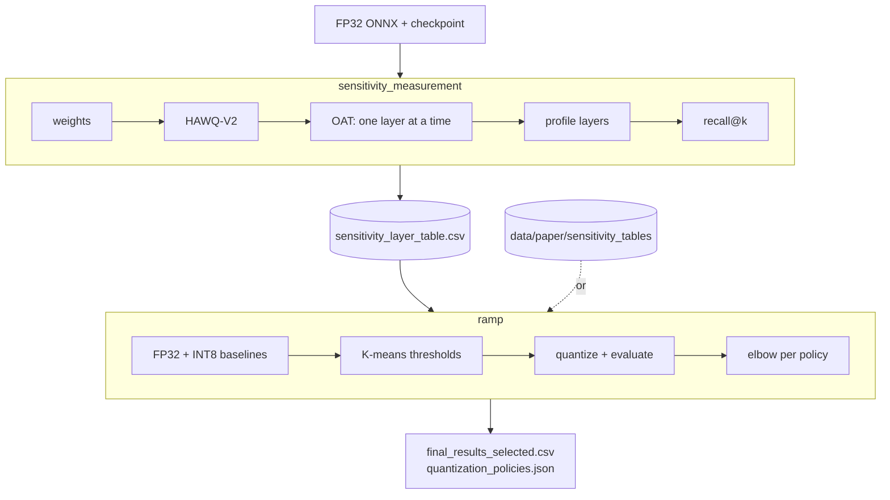

# RAMP: Robust Adaptive Mixed-Precision Quantization for Edge CPU Vision Models

[](https://arxiv.org/abs/2609.28262)
[](https://hf.co/collections/davidpblcrd/ramp-robust-adaptive-mpq-for-edge-cpu)
[](https://huggingface.co/datasets/HPAI-BSC/SuSy-Dataset)
[](LICENSE)
[](pyproject.toml)

Official implementation of **RAMP: Robust Adaptive Mixed-Precision Quantization for Edge CPU Vision Models**, accepted
at the *British Machine Vision Conference (BMVC) 2026*.

**Authors:** David Población-Criado<sup>1,2</sup>, Dario Garcia-Gasulla<sup>1</sup>, Eduardo Quinones<sup>1</sup>

<sup>1</sup>Barcelona Supercomputing Center (BSC), Barcelona, Spain

<sup>2</sup>Universitat Politècnica de Catalunya - BarcelonaTech (UPC), Barcelona, Spain

## Installation
This project uses [uv](https://docs.astral.sh/uv/) as package manager. To install all dependencies needed just run
`uv sync`.

## Models
The four FP32 models of the paper are on the Hugging Face Hub, each with the quantization policies RAMP selected for
it on both devices:

| Model | Repository | Experiment |
| --- | --- | --- |
| ResNet-18 | [davidpblcrd/ramp-susy-resnet18](https://huggingface.co/davidpblcrd/ramp-susy-resnet18) | `timm_resnet18_susy` |
| EfficientNet-B0 | [davidpblcrd/ramp-susy-efficientnet-b0](https://huggingface.co/davidpblcrd/ramp-susy-efficientnet-b0) | `timm_efficientnet-b0_susy` |
| ConvNeXt-Tiny | [davidpblcrd/ramp-susy-convnext-tiny](https://huggingface.co/davidpblcrd/ramp-susy-convnext-tiny) | `timm_convnext_tiny_susy` |
| TinyViT | [davidpblcrd/ramp-susy-tinyvit](https://huggingface.co/davidpblcrd/ramp-susy-tinyvit) | `timm_tinyvit_susy` |

Download them into `models/hf/` (not tracked by git) and link each ONNX where its experiment expects it,
`models/susy-classification/fp32/<name>/model.onnx`:

```bash
for pair in resnet18:timm_resnet18 efficientnet-b0:timm_efficientnet-b0 convnext-tiny:timm_convnext_tiny tinyvit:timm_tinyvit; do
    model=${pair%%:*} name=${pair##*:}
    hf download davidpblcrd/ramp-susy-$model --local-dir models/hf/ramp-susy-$model
    mkdir -p models/susy-classification/fp32/$name
    ln -sf "$PWD/models/hf/ramp-susy-$model/${model}_fp32.onnx" models/susy-classification/fp32/$name/model.onnx
done
```

Only the ONNX models are published. The PyTorch stage of the sensitivity flow (HAWQ-V2) needs the training
checkpoint as `model.pth` next to the ONNX; without it, run with `steps.analyze_weights_pytorch=false`.

## Dataset

The [SuSy Dataset](https://huggingface.co/datasets/HPAI-BSC/SuSy-Dataset) is downloaded the same way,
into `data/SuSy-Dataset/`. Unpack the three splits in place:

```bash
hf download HPAI-BSC/SuSy-Dataset --repo-type dataset --local-dir data/SuSy-Dataset
for split in train val test; do unzip -q data/SuSy-Dataset/data/$split.zip -d data/SuSy-Dataset/data; done
```

The flows read `${paths.data_dir}/SuSy-Dataset/data/{train,val,test}/<class>/`; `paths.data_dir` defaults to
`~/datalake`, so add `paths.data_dir=$PWD/data` to the commands below or change it in `config/paths/local.yaml`.

## Project Structure

```
ramp-mpq/
├── config/          # Hydra configs
├── data/
│   ├── paper/       # paper's sensitivity tables, per model and device
│   └── profiling/   # Cortex-A76 per-node traces used to filter layers
├── scripts/         # launchers (ramp.sh, sensitivity_measurement.sh, run_all.sh) and checks
└── src/
    ├── flows/
    │   ├── sensitivity_measurement/   # per-layer sensitivity table
    │   └── ramp/                      # mixed-precision policies from that table
    ├── quantization/  # ONNX quantization, evaluation and profiling
    ├── metrics/       # JSD, KL, SNR, HAWQ-V2, recall@k
    └── models/, data/, utils/
```

## Flows


## Sensitivity Measurement
Stages, in the order they run (each one can be toggled with `steps.<name>`):
1. Analyze weights: from the FP32 ONNX model, computes the weight statistics of every quantizable node: STD, mean, min, max, value count, sample count, range ratio, channel range CV and estimated SQNR (`weights_per_node_stats.csv`).
2. HAWQ-V2: from the PyTorch checkpoint, estimates each layer's Hessian trace on the calibration data and multiplies it by the layer's INT8 weight quantization error to get its HAWQ-V2 score (`hessian_trace_stats.csv`, `hawqv2_scores.csv`). Needs `model.pth` (see [Models](#models)).
3. OAT, one layer at a time: quantizes each node to INT8 alone, keeping the rest in FP32 and compares the partially quantized model with the FP32 one on the test set: JSD, KL, MSE, MAE, NRMSE, cosine distance, SNR, accuracy drop and latency (`oat_sensitivity_results.csv`). The accuracy drop is the ground truth for the last step.
4. Profile layers: profiles the FP32 and the fully quantized model with ONNX Runtime and writes each node's kernel time (`dur_s_fp32`, `dur_s_int8`) to `layer_profiling.csv` and to the layer table. These timings belong to the machine the flow runs on, so run it **on the target device** if the table will feed `ramp`.
5. Recall@top-k: joins the outputs of the previous steps into one per-layer table, `sensitivity_layer_table.csv` (the input of `ramp`), and measures how many of the truly most sensitive layers (top 10/20/30% by accuracy drop) each proxy metric recovers (`recall_top_k.csv`).

### Configuration
Hydra composes `config/sensitivity_measurement.yaml` from these groups:

| Group | Purpose |
| --- | --- |
| `experiment` | Binds model, dataset, checkpoints and `image_size` as one unit. Switch this, never the four separately. |
| `paths` | `root_dir`, `data_dir` and `output_dir`. |
| `logger` | W&B project, entity and mode. |
| `data`, `model` | Selected by the experiment; override only for one-off runs. |

Environment variables:

```bash
export PROJECT_ROOT=$(pwd)         # required by config/paths/local.yaml
export WANDB_ENTITY=<your-entity>  # optional
export WANDB_MODE=online           # defaults to offline
```

Run:

```bash
python -m src.flows.sensitivity_measurement.sensitivity_measurement
```

Common overrides:

```bash
# select the experiment
experiment=timm_convnext_tiny_susy
# toggle stages
steps.analyze_weights=true steps.analyze_weights_pytorch=false steps.analyze_oat=true
# restrict OAT to specific ONNX nodes (default: every quantizable node)
'layers_to_analyze=[/features/0/Conv,/features/3/Conv]'
# run the PyTorch stage on GPU
use_gpu=true
```

To add a model, copy `config/experiment/timm_convnext_tiny_susy.yaml`, point `/model` and the
`onnx_file` / `pytorch_file` paths at the new checkpoints, and select it with `experiment=<name>`.
Results (CSV, plots, `.npz` samples) land in the Hydra run directory and are logged to W&B as artifacts.

## RAMP Method
The `ramp` flow turns a per-layer sensitivity table into mixed-precision policies and measures them on the
device it runs on. Run it **on the target device**, with that device's table:

```bash
./scripts/ramp.sh              # Raspberry Pi 5 (Cortex-A76)
./scripts/ramp.sh apple-m1     # Apple M1
```

The paper's per-layer sensitivity tables, one per model and device, are in `data/paper/sensitivity_tables/`.

For each policy (STD, HAWQ-V2, JSD, and JSD + Latency, which drops the layers that do not speed up on the device),
layers are split by K-means thresholds on the metric, and each resulting configuration is quantized and evaluated
on the full test set. **One candidate per policy** is then chosen with the elbow method: accuracy and latency are
min-max normalised over the policy's sweep together with the FP32 model, and the configuration maximising
`acc_norm - lat_norm` is kept. FP32 anchors both scales but is never selected; without it, a sweep whose only
accurate candidate is also its slowest one would favour a collapsed, faster candidate.
FP32 and uniform INT8 are reported as references.

Outputs, in the Hydra run directory and as W&B artifacts:
- `final_results_selected.csv`: the selected candidate per policy (the paper's results table).
- `final_results.csv`: every configuration of every sweep.
- `quantization_policies.json`: the precision (`int8`/`fp32`) of every quantizable node for each configuration;
  the selected ones are marked in `selected_for`.
- The quantized ONNX of every configuration, uploaded to `upload.s3_uri` and logged as a W&B reference artifact
  (`quantized-onnx-<model>`; W&B stores only paths and checksums). Credentials are read from `~/.aws/credentials`.
  Set `upload.s3_uri=null` to skip the upload.

Latency depends on the device and its conditions, and it drives which candidate the elbow picks, so the selected
configurations are only comparable across runs measured on the same hardware.

## Acknowledgements
This work was partially funded by two projects: (1) DARE SGA1, which has received funding from the European
High-Performance Computing Joint Undertaking (JU) under grant agreement No 101202459; and (2) ODISSEE, which has
received funding from the European Union's Horizon Europe research and innovation programme under grant agreement
No 101188332.

## License
This project is released under the [Apache 2.0 License](LICENSE).